<p align="center">
  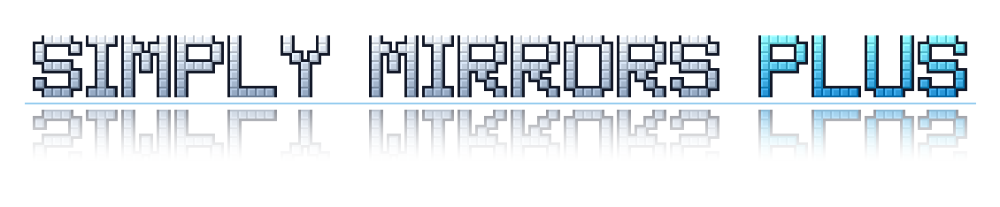
</p>

<p align="center">
  Mirrors that reflect the world live, for Minecraft 1.14.4 to 26.3 on Fabric, Forge and NeoForge.
</p>

Simply Mirrors Plus is based on [Simply Mirrors](https://github.com/UpperMoon0/Simply-Mirrors) by NsTut.

<table>
  <tr>
    <td width="50%">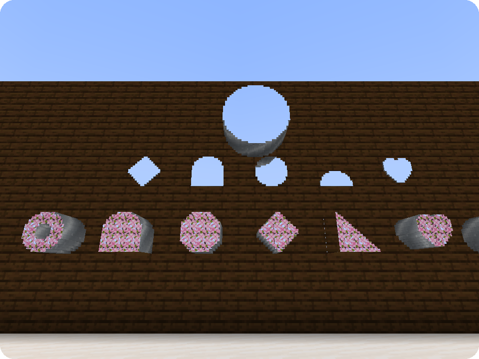</td>
    <td width="50%">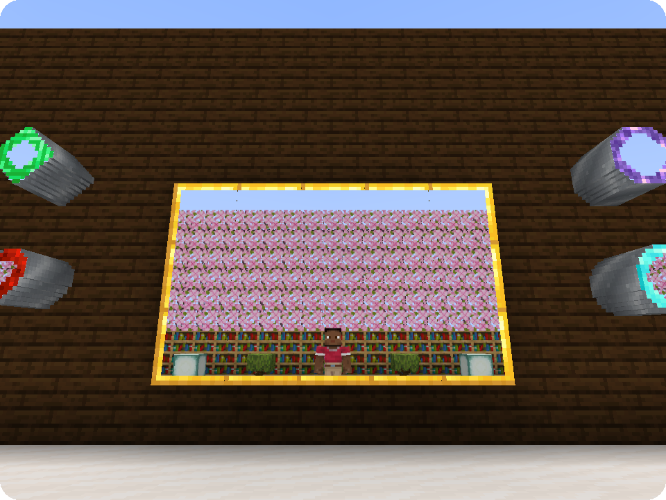</td>
  </tr>
  <tr>
    <td>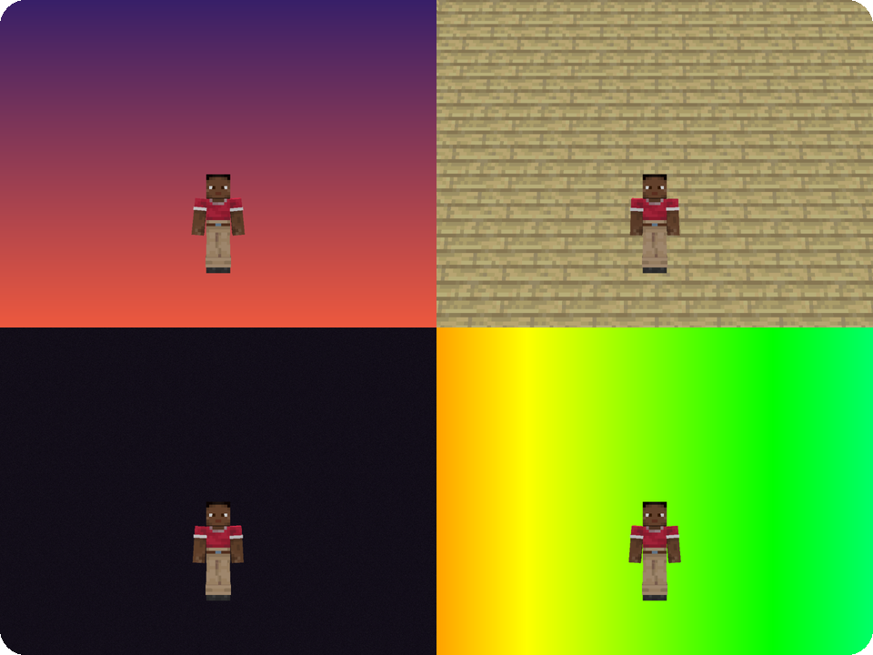</td>
    <td>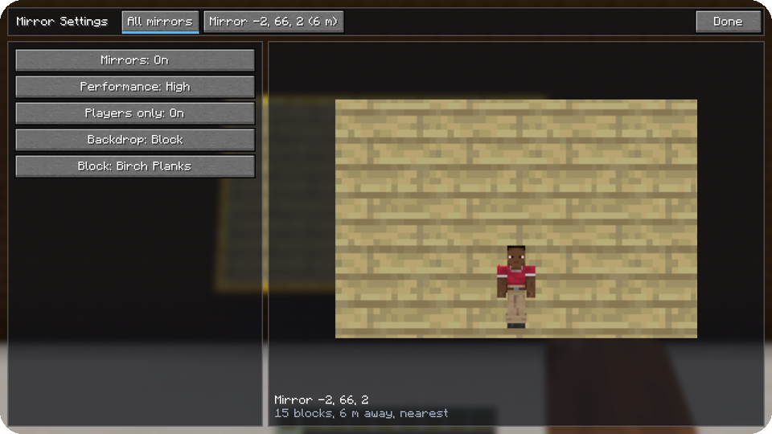</td>
  </tr>
</table>

<p align="center">
  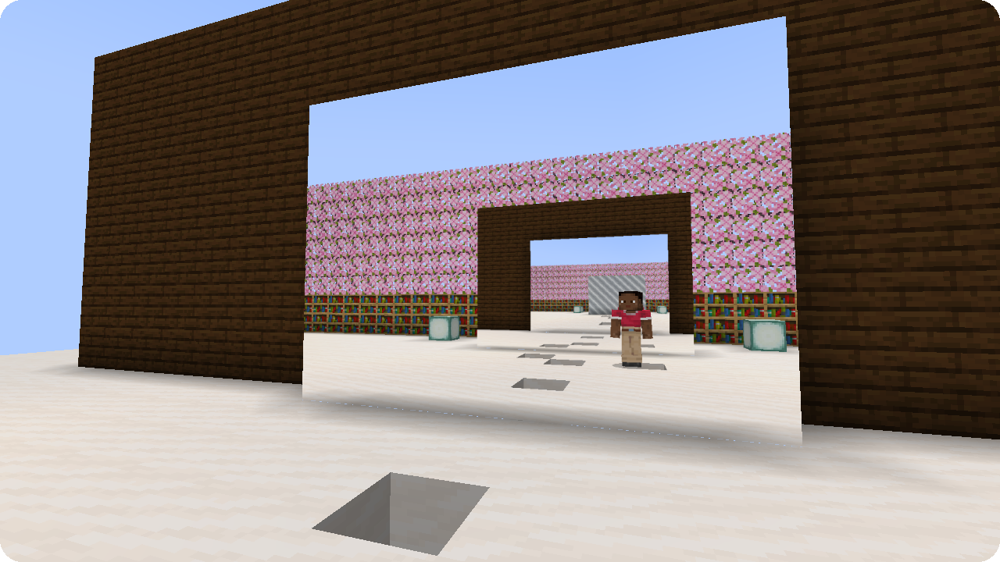
</p>

## Recipes

| | |
| --- | --- |
| **Mirror.** Eight glass blocks around an iron ingot make eight mirrors. | 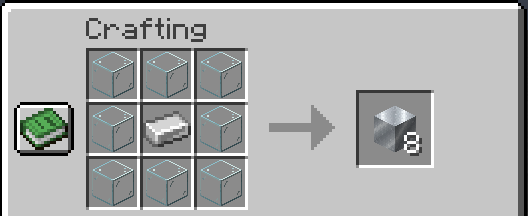 |
| **Forms.** Put a mirror in a stonecutter and pick one of the 22. Any form cuts into any other, one for one; a slab is half a block, so you get two. | 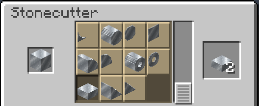 |
| **Forms by hand.** A single mirror in the crafting grid becomes the next form in the list. | 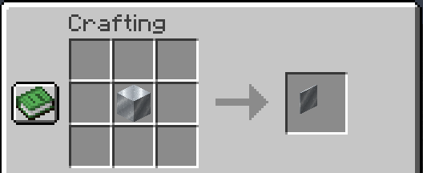 |
| **Slabs by hand.** Three mirrors in a row make six slabs. |  |
| **Back to a block.** Two slabs on top of each other make a mirror. | 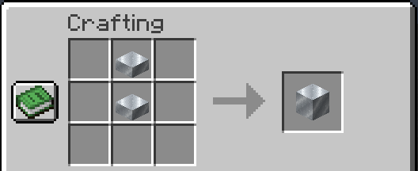 |
| **Frame.** A mirror and any one block, anywhere in the crafting grid. | 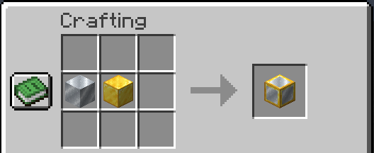 |
| **Mirror Wrench.** Three iron ingots and a glass block. | 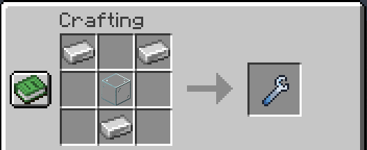 |

## Mirrors

- Every side of a mirror reflects, in every form: a round mirror block is a mirror all the way around. Mirrors that touch form one surface, on walls, floors and ceilings.
- A mirror in view is redrawn with every frame of the game.
- A mirror seen inside a reflection reflects too.
- A mirror behind a wall, or outside your view, is not drawn at all.
- Looking at a mirror does not draw the block outline over it.
- Mirrors sound like glass and break fast with a pickaxe.

## Forms

There are 23 forms: the full block, a slab, a square panel, and ten outlines (round, half round, quarter round, corner fill, triangle, diamond, octagon, arch, ring, heart). Each outline comes as a solid block and as a thin panel. Each form is its own item.

- A shaped mirror sits on the side of the block you click and turns towards the corner you click.
- Round mirrors join by themselves. Side by side, only the outer corners of the group stay round. Full mirror blocks join them too.
- Two mirror slabs in one block make a full block and drop as two slabs.
- A broken mirror drops in its form.

The **Mirror Wrench** turns a mirror's outline a quarter when used on it. Sneak and use it on a round mirror to stop it from joining its neighbours, or to let it join again.

## Frames

A framed mirror shows its frame in the block's own texture: on the placed mirror, on the item in your hand and inventory, and by name in the tooltip. Blocks from other mods work as frames.

Framed mirrors that touch share one frame around all of them. A broken mirror keeps its frame. Cutting a framed mirror into another form removes the frame.

## Settings

Press `M`, or sneak and right-click a mirror with an empty hand to open that mirror's page. The key can be changed under Controls. Mod Menu and the Forge and NeoForge mod lists open the same screen.

| Setting | Values |
| --- | --- |
| Mirrors | On or off, for all mirrors |
| Performance | Low, Medium, High or Max |
| Players only | Reflect only players, in front of a backdrop |
| Overwrite default settings | Gives one mirror its own name, mode and backdrop |
| Mode (one mirror) | Normal, Players only or Off |
| Backdrop | End sky, a block, a colour, a gradient, a picture or a panorama |

| Performance | Low | Medium | High | Max |
| --- | --- | --- | --- | --- |
| Resolution | 50% | 75% | 100% | 100% |
| Surfaces redrawn every frame | 2 | 3 | 6 | 12 |
| Surfaces that keep an image | 8 | 12 | 24 | 48 |
| Mirrors found within | 48 blocks | 64 blocks | 96 blocks | 160 blocks |
| Reflections inside a reflection, per frame | 0 | 1 | 3 | 8 |

Surfaces past the per-frame number are redrawn in turn and show their last image meanwhile.

For a picture backdrop, press **Choose file** on the picture page, drop picture files (PNG or JPEG) on the game window while the settings are open, or put them in `config/simplymirrorsplus/backgrounds/`.

Settings are stored in `config/simplymirrorsplus.properties`. The settings of single mirrors are stored per world in `config/simplymirrorsplus/mirrors/`. Both belong to your game, not to the server.

## Versions

| Minecraft | Loaders |
| --- | --- |
| 26.3, 26.2, 26.1.2 | Fabric, NeoForge |
| 26.1.1, 26.1 | Fabric |
| 1.21.11, 1.21.10, 1.21.8, 1.21.5, 1.21.4, 1.21.3, 1.21.1 | Fabric, NeoForge |
| 1.20.6, 1.20.4 | Fabric, NeoForge |
| 1.20.2 | Fabric |
| 1.20.1, 1.19.4, 1.19.3, 1.19.2, 1.18.2, 1.17.1, 1.16.5, 1.15.2 | Fabric, Forge |
| 1.14.4 | Fabric |

Each jar is built for one Minecraft version. The 1.21.10 jars also run on 1.21.9. Fabric builds need [Fabric API](https://modrinth.com/mod/fabric-api).

## Building

All versions build from one source tree. Code that differs between Minecraft versions sits behind [Stonecutter](https://stonecutter.kikugie.dev/) conditions such as `//? if >=1.21 {`.

| Path | Contents |
| --- | --- |
| `core/` | The mirror engine, its math and its OpenGL code. Java 8, no Minecraft classes. |
| `src/` | Everything that touches Minecraft. `fabric/`, `forge/` and `neoforge/` hold the loader entry points. |
| `tools/shapes.py` | Generates the models, block states, items, recipes and loot of the forms from one mask per outline. |
| `settings.gradle.kts` | The list of targets. |
| `stonecutter.properties.toml` | Dependency versions and pack formats per target. |

Gradle needs a Java 25 JDK to run and downloads the JDKs the targets compile with.

```sh
./gradlew collectJars              # every jar, copied to build/release/
./gradlew :1.21.4-fabric:build     # one target, in versions/1.21.4-fabric/build/libs/
```

The sources on disk show one target at a time, 1.21.4 Fabric by default. Run `./gradlew "Set active project to 1.20.1-forge"` to edit against another, and `./gradlew "Reset active project"` before committing.

## License

MIT. See [LICENSE](LICENSE) and [NOTICE](NOTICE).
