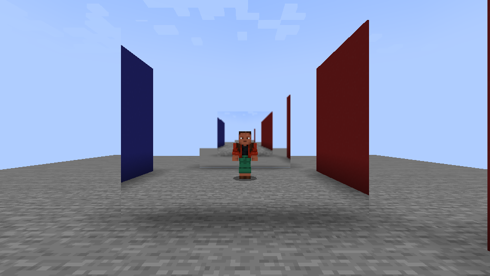
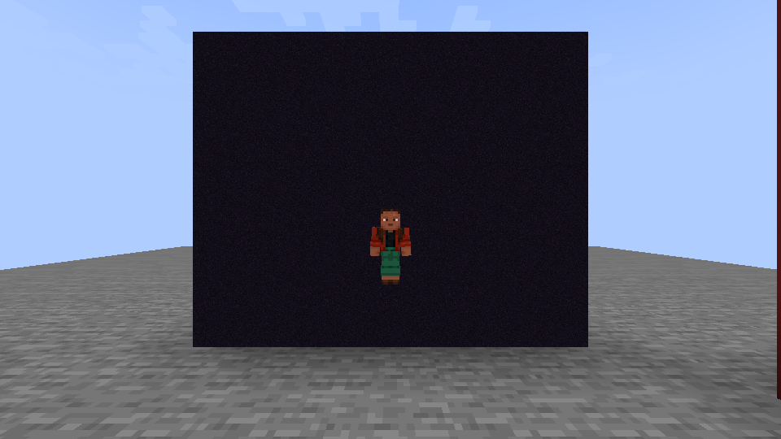
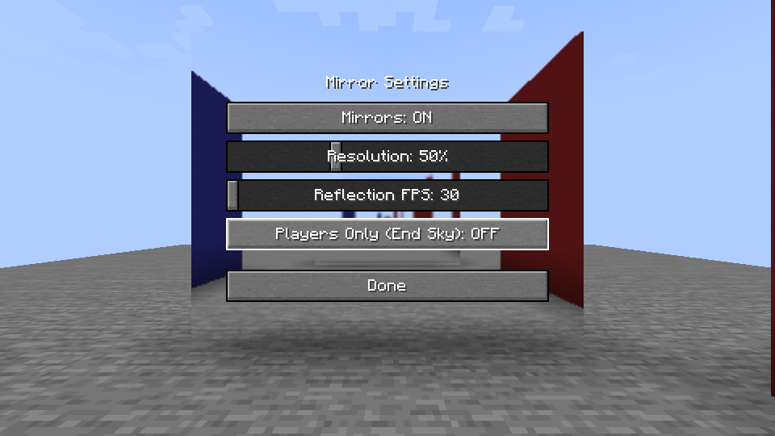

Craftable full-block mirrors that show a live reflection of the world around them. Every face of the block reflects, and neighboring mirrors join into one surface, so you can build mirrored walls, floors and ceilings.

Craft a mirror from eight glass blocks around an iron ingot, or take one from the Simply Mirrors Plus creative tab.

Simply Mirrors Plus is based on [Simply Mirrors](https://www.curseforge.com/minecraft/mc-mods/simply-mirrors) by NsTut.

### Mirrors inside mirrors

A mirror you can see in a reflection reflects too. Two bounces are rendered, and deeper ones reuse the mirror's latest image, so facing mirrors keep going instead of ending on the block texture.

### Players Only

Turn this on and mirrors show only players in front of the End sky, like a VRChat mirror. The world is not drawn in the reflection at all.

### Lighter reflections

Each mirror keeps its own image and only redraws it at the rate you choose. Between refreshes it reuses the last image, and at most two mirror surfaces refresh in a single frame.

Press `M` in game to open the settings. You can change the key under Controls. The mirrors stay visible behind the menu, so you see each change as you make it.

| Setting | Values |
| --- | --- |
| Mirrors | On or off |
| Resolution | 25% to 100% of the screen, in 5% steps |
| Reflection FPS | 30, 60, 90 or 120 |
| Players Only (End Sky) | On or off |

Settings are saved in `config/simplymirrorsplus.properties`.

| Minecraft | Loaders |
| --- | --- |
| 26.1.2 | Fabric, NeoForge |
| 1.21.4 | Fabric |
| 1.21.1 | Fabric, NeoForge |
| 1.20.1 | Fabric, Forge |
| 1.16.5 | Fabric, Forge |

Every version has the same features. Fabric builds need Fabric API.

Sodium and Iris are supported. With a shader pack active, reflections render at 100% resolution and a mirror seen inside a reflection shows its block texture.

Original mod: [Simply Mirrors](https://www.curseforge.com/minecraft/mc-mods/simply-mirrors) by NsTut. Port, new features and fixes by malidev.

Source code is on [GitHub](https://github.com/malithedeveloper/simplymirrorsplus) under the MIT license.
